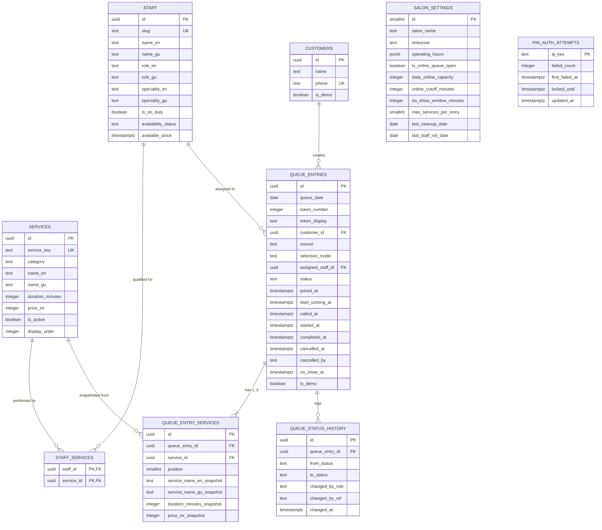

# CELESTE — Database Design Specification

**Project:** CELESTE — Salon Queue Management System  
**Database:** PostgreSQL (Supabase)  
**Timezone:** `Asia/Kolkata` (India Standard Time / IST)  
**Status:** Approved & Implementation-Ready  
**Related Documents:** [docs/01-brief.md](01-brief.md), [docs/02-screens.md](02-screens.md), [docs/03-flows-rules.md](03-flows-rules.md)

---

## 1. Architecture Overview

CELESTE uses **9 PostgreSQL tables** (8 core domain tables + 1 security rate-limit table) and **1 read-only SQL view**:

| Type | Name | Purpose |
|---|---|---|
| Domain Table | `services` | Service catalogue (33 initial services, EN/GU names, duration, INR price, active state) |
| Domain Table | `staff` | Staff profiles (5 initial stylists, EN/GU names/roles/specialities, duty & availability) |
| Domain Table | `staff_services` | Many-to-Many eligibility matrix mapping staff to qualified services (140 initial rows) |
| Domain Table | `customers` | Private customer PII table (`name`, unique 10-digit `phone`, `is_demo`) |
| Domain Table | `queue_entries` | Daily queue tickets (`queue_date`, `token_number`, `token_display`, status, timestamps) |
| Domain Table | `queue_entry_services` | 1–3 booked services per ticket with immutable price/duration/name snapshots |
| Domain Table | `queue_status_history` | Immutable audit log of every status transition and acting role |
| Domain Table | `salon_settings` | Singleton configuration (`id = 1`), operating hours, limits, cleanup/init dates |
| Security Table | `pin_auth_attempts` | Serverless-safe PostgreSQL brute-force lockout tracking for shared PIN auth |
| SQL View | `daily_queue_statistics` | Dynamic daily and historical metrics computed from `queue_entries` + `queue_entry_services` |

### Core Architectural Principles
- **Zero PII in public tables or Realtime:** Customer names and 10-digit phone numbers live exclusively in `customers` (RLS Deny-All). `queue_entries` stores no customer names or phone numbers.
- **Calculated values are not redundantly stored:** Queue positions, estimated waiting times, elapsed/remaining service times, booking totals, and daily statistics are computed dynamically from timestamps and snapshots.
- **Server-side authority:** All queue mutations, assignments, and PII reads execute through validated Express API endpoints using `SUPABASE_SECRET_KEY` (`service_role`).

---

## 2. Table & View Specifications

### 2.1 `services`
| Column | PostgreSQL Type | Constraints & Defaults |
|---|---|---|
| `id` | `UUID` | `PRIMARY KEY DEFAULT gen_random_uuid()` |
| `service_key` | `TEXT` | `NOT NULL UNIQUE CHECK (service_key ~ '^[a-z0-9-]+$')` |
| `category` | `TEXT` | `NOT NULL CHECK (category IN ('Hair', 'Beard & Grooming', 'Skin', 'Hands & Feet'))` |
| `name_en` | `TEXT` | `NOT NULL CHECK (char_length(btrim(name_en)) > 0)` |
| `name_gu` | `TEXT` | `NOT NULL CHECK (char_length(btrim(name_gu)) > 0)` |
| `duration_minutes` | `INTEGER` | `NOT NULL CHECK (duration_minutes > 0)` |
| `price_inr` | `INTEGER` | `NOT NULL CHECK (price_inr >= 0)` |
| `is_active` | `BOOLEAN` | `NOT NULL DEFAULT TRUE` |
| `display_order` | `INTEGER` | `NOT NULL DEFAULT 0` |
| `created_at` | `TIMESTAMPTZ` | `NOT NULL DEFAULT NOW()` |
| `updated_at` | `TIMESTAMPTZ` | `NOT NULL DEFAULT NOW()` |

**Indexes:**
- `idx_services_active_order` on `(is_active, category, display_order)`

### 2.2 `staff`
| Column | PostgreSQL Type | Constraints & Defaults |
|---|---|---|
| `id` | `UUID` | `PRIMARY KEY DEFAULT gen_random_uuid()` |
| `slug` | `TEXT` | `NOT NULL UNIQUE CHECK (slug ~ '^[a-z0-9-]+$')` |
| `name_en` | `TEXT` | `NOT NULL CHECK (char_length(btrim(name_en)) > 0)` |
| `name_gu` | `TEXT` | `NOT NULL CHECK (char_length(btrim(name_gu)) > 0)` |
| `role_en` | `TEXT` | `NOT NULL CHECK (char_length(btrim(role_en)) > 0)` |
| `role_gu` | `TEXT` | `NOT NULL CHECK (char_length(btrim(role_gu)) > 0)` |
| `speciality_en` | `TEXT` | `NOT NULL CHECK (char_length(btrim(speciality_en)) > 0)` |
| `speciality_gu` | `TEXT` | `NOT NULL CHECK (char_length(btrim(speciality_gu)) > 0)` |
| `avatar_url` | `TEXT` | `NULL` |
| `is_on_duty` | `BOOLEAN` | `NOT NULL DEFAULT TRUE` |
| `availability_status` | `TEXT` | `NOT NULL DEFAULT 'Available' CHECK (availability_status IN ('Available', 'Busy', 'On Break'))` |
| `available_since` | `TIMESTAMPTZ` | `NOT NULL DEFAULT NOW()` |
| `display_order` | `INTEGER` | `NOT NULL DEFAULT 0` |
| `created_at` | `TIMESTAMPTZ` | `NOT NULL DEFAULT NOW()` |
| `updated_at` | `TIMESTAMPTZ` | `NOT NULL DEFAULT NOW()` |

**Indexes:**
- `idx_staff_duty_avail` on `(is_on_duty, availability_status, available_since)`

### 2.3 `staff_services`
| Column | PostgreSQL Type | Constraints & Defaults |
|---|---|---|
| `staff_id` | `UUID` | `NOT NULL REFERENCES public.staff(id) ON DELETE CASCADE` |
| `service_id` | `UUID` | `NOT NULL REFERENCES public.services(id) ON DELETE CASCADE` |
| `created_at` | `TIMESTAMPTZ` | `NOT NULL DEFAULT NOW()` |

**Constraints & Indexes:**
- `PRIMARY KEY (staff_id, service_id)`
- `idx_staff_services_service` on `(service_id, staff_id)` (fast reverse lookup of all staff qualified for a service)

### 2.4 `customers` *(Private PII)*
| Column | PostgreSQL Type | Constraints & Defaults |
|---|---|---|
| `id` | `UUID` | `PRIMARY KEY DEFAULT gen_random_uuid()` |
| `name` | `TEXT` | `NOT NULL CHECK (char_length(btrim(name)) > 0)` |
| `phone` | `TEXT` | `NOT NULL UNIQUE CHECK (phone ~ '^[0-9]{10}$')` |
| `is_demo` | `BOOLEAN` | `NOT NULL DEFAULT FALSE` |
| `created_at` | `TIMESTAMPTZ` | `NOT NULL DEFAULT NOW()` |
| `updated_at` | `TIMESTAMPTZ` | `NOT NULL DEFAULT NOW()` |

### 2.5 `queue_entries`
| Column | PostgreSQL Type | Constraints & Defaults |
|---|---|---|
| `id` | `UUID` | `PRIMARY KEY DEFAULT gen_random_uuid()` |
| `queue_date` | `DATE` | `NOT NULL` |
| `token_number` | `INTEGER` | `NOT NULL CHECK (token_number > 0)` |
| `token_display` | `TEXT` | `GENERATED ALWAYS AS ('S-' || CASE WHEN token_number < 100 THEN LPAD(token_number::TEXT, 2, '0') ELSE token_number::TEXT END) STORED` |
| `customer_id` | `UUID` | `NOT NULL REFERENCES public.customers(id) ON DELETE RESTRICT` |
| `source` | `TEXT` | `NOT NULL CHECK (source IN ('online', 'walk_in'))` |
| `selection_mode` | `TEXT` | `NOT NULL CHECK (selection_mode IN ('specific', 'any_available'))` |
| `assigned_staff_id` | `UUID` | `NOT NULL REFERENCES public.staff(id) ON DELETE RESTRICT` |
| `status` | `TEXT` | `NOT NULL DEFAULT 'Waiting' CHECK (status IN ('Waiting', 'Called', 'In Chair', 'Done', 'Cancelled', 'No-show'))` |
| `joined_at` | `TIMESTAMPTZ` | `NOT NULL DEFAULT NOW()` |
| `start_coming_at` | `TIMESTAMPTZ` | `NULL` |
| `called_at` | `TIMESTAMPTZ` | `NULL` |
| `started_at` | `TIMESTAMPTZ` | `NULL` |
| `completed_at` | `TIMESTAMPTZ` | `NULL` |
| `cancelled_at` | `TIMESTAMPTZ` | `NULL` |
| `cancelled_by` | `TEXT` | `NULL CHECK (cancelled_by IN ('customer', 'reception', 'system'))` |
| `no_show_at` | `TIMESTAMPTZ` | `NULL` |
| `is_demo` | `BOOLEAN` | `NOT NULL DEFAULT FALSE` |
| `created_at` | `TIMESTAMPTZ` | `NOT NULL DEFAULT NOW()` |
| `updated_at` | `TIMESTAMPTZ` | `NOT NULL DEFAULT NOW()` |

**Table-Level Constraints:**
- `UNIQUE (queue_date, token_number)` — guarantees unique daily tokens; Cancelled and No-show tokens are never reused.
- Mutually exclusive lifecycle `CHECK` constraints:
  - `chk_qe_waiting`: `status <> 'Waiting' OR (called_at IS NULL AND started_at IS NULL AND completed_at IS NULL AND cancelled_at IS NULL AND cancelled_by IS NULL AND no_show_at IS NULL)`
  - `chk_qe_called`: `status <> 'Called' OR (called_at IS NOT NULL AND started_at IS NULL AND completed_at IS NULL AND cancelled_at IS NULL AND cancelled_by IS NULL AND no_show_at IS NULL)`
  - `chk_qe_in_chair`: `status <> 'In Chair' OR (called_at IS NOT NULL AND started_at IS NOT NULL AND completed_at IS NULL AND cancelled_at IS NULL AND cancelled_by IS NULL AND no_show_at IS NULL)`
  - `chk_qe_done`: `status <> 'Done' OR (called_at IS NOT NULL AND started_at IS NOT NULL AND completed_at IS NOT NULL AND completed_at >= started_at AND cancelled_at IS NULL AND cancelled_by IS NULL AND no_show_at IS NULL)`
  - `chk_qe_cancelled`: `status <> 'Cancelled' OR (cancelled_at IS NOT NULL AND cancelled_by IS NOT NULL AND started_at IS NULL AND completed_at IS NULL AND no_show_at IS NULL)`
  - `chk_qe_no_show`: `status <> 'No-show' OR (called_at IS NOT NULL AND no_show_at IS NOT NULL AND no_show_at >= called_at + INTERVAL '10 minutes' AND started_at IS NULL AND completed_at IS NULL AND cancelled_at IS NULL AND cancelled_by IS NULL)`

**Indexes & Partial Unique Indexes:**
- `uq_one_active_entry_per_customer_day` (`UNIQUE`): `(queue_date, customer_id) WHERE status IN ('Waiting', 'Called', 'In Chair')`
- `uq_one_active_chair_per_staff_day` (`UNIQUE`): `(queue_date, assigned_staff_id) WHERE status IN ('Called', 'In Chair')`
- `idx_queue_staff_fcfs`: `(queue_date, assigned_staff_id, status, joined_at, token_number)`
- `idx_queue_date_status_joined`: `(queue_date, status, joined_at)`
- `idx_queue_online_capacity`: `(queue_date, source) WHERE status <> 'Cancelled'`
- `idx_queue_demo_date`: `(queue_date) WHERE is_demo = TRUE`

### 2.6 `queue_entry_services`
| Column | PostgreSQL Type | Constraints & Defaults |
|---|---|---|
| `id` | `UUID` | `PRIMARY KEY DEFAULT gen_random_uuid()` |
| `queue_entry_id` | `UUID` | `NOT NULL REFERENCES public.queue_entries(id) ON DELETE CASCADE` |
| `service_id` | `UUID` | `NOT NULL REFERENCES public.services(id) ON DELETE RESTRICT` |
| `position` | `SMALLINT` | `NOT NULL CHECK (position BETWEEN 1 AND 3)` |
| `service_name_en_snapshot` | `TEXT` | `NOT NULL` |
| `service_name_gu_snapshot` | `TEXT` | `NOT NULL` |
| `duration_minutes_snapshot` | `INTEGER` | `NOT NULL CHECK (duration_minutes_snapshot > 0)` |
| `price_inr_snapshot` | `INTEGER` | `NOT NULL CHECK (price_inr_snapshot >= 0)` |
| `created_at` | `TIMESTAMPTZ` | `NOT NULL DEFAULT NOW()` |

**Constraints & Indexes:**
- `UNIQUE (queue_entry_id, position)` — enforces maximum of 3 services per entry.
- `UNIQUE (queue_entry_id, service_id)` — prevents duplicate selection of the same service within one entry.
- `idx_qes_service_id` on `(service_id)`

### 2.7 `queue_status_history` *(Private Audit Trail)*
| Column | PostgreSQL Type | Constraints & Defaults |
|---|---|---|
| `id` | `UUID` | `PRIMARY KEY DEFAULT gen_random_uuid()` |
| `queue_entry_id` | `UUID` | `NOT NULL REFERENCES public.queue_entries(id) ON DELETE CASCADE` |
| `from_status` | `TEXT` | `NULL CHECK (from_status IN ('Waiting', 'Called', 'In Chair', 'Done', 'Cancelled', 'No-show'))` |
| `to_status` | `TEXT` | `NOT NULL CHECK (to_status IN ('Waiting', 'Called', 'In Chair', 'Done', 'Cancelled', 'No-show'))` |
| `changed_by_role` | `TEXT` | `NOT NULL CHECK (changed_by_role IN ('customer', 'reception', 'staff', 'owner', 'system'))` |
| `changed_by_ref` | `TEXT` | `NULL` |
| `note` | `TEXT` | `NULL` |
| `changed_at` | `TIMESTAMPTZ` | `NOT NULL DEFAULT NOW()` |

**Indexes:**
- `idx_qsh_entry_time` on `(queue_entry_id, changed_at DESC)`

### 2.8 `salon_settings`
| Column | PostgreSQL Type | Constraints & Defaults |
|---|---|---|
| `id` | `SMALLINT` | `PRIMARY KEY DEFAULT 1 CHECK (id = 1)` |
| `salon_name` | `TEXT` | `NOT NULL DEFAULT 'CELESTE'` |
| `timezone` | `TEXT` | `NOT NULL DEFAULT 'Asia/Kolkata'` |
| `operating_hours` | `JSONB` | `NOT NULL CHECK (jsonb_typeof(operating_hours) = 'object')` — keys `mon`..`sun` with 24-hour `HH:MM` `{"open": "HH:MM", "close": "HH:MM"}` (`[open, close)`) |
| `is_online_queue_open` | `BOOLEAN` | `NOT NULL DEFAULT TRUE` |
| `daily_online_capacity` | `INTEGER` | `NOT NULL DEFAULT 30 CHECK (daily_online_capacity >= 0)` |
| `online_cutoff_minutes` | `INTEGER` | `NOT NULL DEFAULT 30 CHECK (online_cutoff_minutes >= 0)` |
| `no_show_window_minutes` | `INTEGER` | `NOT NULL DEFAULT 10 CHECK (no_show_window_minutes = 10)` |
| `max_services_per_entry` | `SMALLINT` | `NOT NULL DEFAULT 3 CHECK (max_services_per_entry = 3)` |
| `last_cleanup_date` | `DATE` | `NULL` |
| `last_staff_init_date` | `DATE` | `NULL` |
| `updated_at` | `TIMESTAMPTZ` | `NOT NULL DEFAULT NOW()` |

### 2.9 `pin_auth_attempts` *(Private Brute-Force Protection)*
| Column | PostgreSQL Type | Constraints & Defaults |
|---|---|---|
| `ip_key` | `TEXT` | `PRIMARY KEY` |
| `failed_count` | `INTEGER` | `NOT NULL DEFAULT 0 CHECK (failed_count >= 0)` |
| `first_failed_at` | `TIMESTAMPTZ` | `NULL` |
| `locked_until` | `TIMESTAMPTZ` | `NULL` |
| `updated_at` | `TIMESTAMPTZ` | `NOT NULL DEFAULT NOW()` |

### 2.10 Read-Only View: `daily_queue_statistics`
Aggregates `public.queue_entries` and `public.queue_entry_services` grouped by `queue_date`:
- `queue_date`
- `total_entries`
- `waiting_count` (`status = 'Waiting'`)
- `called_count` (`status = 'Called'`)
- `in_chair_count` (`status = 'In Chair'`)
- `served_count` (`status = 'Done'`)
- `cancelled_count` (`status = 'Cancelled'`)
- `no_show_count` (`status = 'No-show'`)
- `completed_services_count` (count of `queue_entry_services` rows belonging to `Done` entries)
- `daily_revenue_inr` (`SUM(price_inr_snapshot)` for `Done` entries)

---

## 3. Relationships & ER Diagram

- **One-to-Many (`1:N`):**
  - `customers (1) → queue_entries (N)`
  - `staff (1) → queue_entries (N)`
  - `queue_entries (1) → queue_entry_services (N)` (strictly 1 to 3 items per entry)
  - `services (1) → queue_entry_services (N)`
  - `queue_entries (1) → queue_status_history (N)`
- **Many-to-Many (`M:N`):**
  - `staff (M) ↔ services (N)` via `staff_services`
- **Singletons:** `salon_settings` (`id = 1`)

---

## 4. Triggers & Atomic RPC Functions

### 4.1 Triggers
1. **`public.set_updated_at()`** (`BEFORE UPDATE` on `services`, `staff`, `customers`, `queue_entries`, `salon_settings`, `pin_auth_attempts`): Sets `NEW.updated_at = pg_catalog.now()`.
2. **`public.enforce_queue_status_transition()`** (`BEFORE UPDATE OF status` on `public.queue_entries`):
   - Permits only: `Waiting → Called|Cancelled`, `Called → In Chair|No-show|Cancelled`, `In Chair → Done`.
   - Rejects `Waiting → No-show`, rejects `Called → No-show` before `called_at + INTERVAL '10 minutes'`, and rejects all transitions out of terminal states (`Done`, `Cancelled`, `No-show`).
3. **`public.log_queue_status_change()`** (`AFTER INSERT OR UPDATE OF status` on `public.queue_entries`):
   - Inserts an immutable row into `public.queue_status_history` using `pg_catalog.current_setting('app.actor_role', true)`, `app.actor_ref`, and `app.transition_note`.

### 4.2 Atomic RPC Functions
All RPCs run inside the caller's database transaction using `SECURITY DEFINER SET search_path = ''` and fully qualified names (`public.*`, `pg_catalog.*`). `get_ist_date()` returns `DATE`, `is_business_day_closed(p_date DATE)` returns `BOOLEAN`, and all mutating RPCs return a consistent `JSONB` envelope (`{ "success": true, "data": { ... }, "message": "..." }`) without exposing customer phone numbers (raising clear PostgreSQL exceptions on invalid operations):

1. **`public.get_ist_date()` / `public.is_business_day_closed(p_date DATE)`**: Evaluates current `Asia/Kolkata` date/time against `public.salon_settings.operating_hours` (`{"mon": {"open": "10:00", "close": "21:00"}, ...}`, Mon–Fri `10:00–21:00`, Sat `09:00–22:00`, Sun `10:00–20:00`, opening inclusive, closing exclusive). Fails with `SALON_SETTINGS_MISSING` if `salon_settings (id = 1)` is absent; identifies non-operating weekdays and dates whose operating period has ended.
2. **`public.run_end_of_day_cleanup()`**:
   - Locks `public.salon_settings WHERE id = 1 FOR UPDATE`.
   - Sets `app.actor_role = 'system'` and `app.transition_note = 'End-of-day automatic cleanup'`.
   - Updates `public.queue_entries` to `status = 'Cancelled'`, `cancelled_at = pg_catalog.now()`, `cancelled_by = 'system'` **only** where `status IN ('Waiting', 'Called')` AND `(queue_date < v_today_ist OR public.is_business_day_closed(queue_date))`.
   - Never modifies `In Chair`, `Done`, `No-show`, or `Cancelled` rows, and **never** alters `public.staff`.
   - Updates `public.salon_settings.last_cleanup_date = v_today_ist`.
3. **`public.initialize_new_day_staff_availability()`** *(Atomic & Idempotent)*:
   - Computes `v_today_ist := (pg_catalog.now() AT TIME ZONE 'Asia/Kolkata')::date`.
   - Acquires row lock: `SELECT last_staff_init_date INTO v_last_init FROM public.salon_settings WHERE id = 1 FOR UPDATE;`
   - If `v_last_init = v_today_ist`, returns immediately without touching `public.staff`.
   - Otherwise, locks eligible `public.staff` rows in deterministic `ORDER BY id ASC FOR UPDATE` and sets `availability_status = 'Available'` and `available_since = pg_catalog.now()` where `is_on_duty = TRUE` and no active `Called`/`In Chair` entry exists on `v_today_ist`, then updates `last_staff_init_date = v_today_ist` in the same transaction.
4. **`public.set_staff_availability(p_staff_id UUID, p_status TEXT, p_actor_role TEXT)`**:
   - Calls `PERFORM public.initialize_new_day_staff_availability();` first.
   - Locks `public.staff` row (`FOR UPDATE`). Rejects `On Break` (and direct `Available` override) if `availability_status = 'Busy'` or an active `Called`/`In Chair` entry exists today; rejects `Available` if off duty. Updates `availability_status` (and `available_since` when transitioning to `Available`).
5. **`public.set_staff_duty(p_staff_id UUID, p_is_on_duty BOOLEAN)`** (Owner):
   - Calls `PERFORM public.initialize_new_day_staff_availability();` first and locks `public.staff` (`FOR UPDATE`).
   - When setting off duty (`FALSE`): rejects if `availability_status = 'Busy'` or an active `Called`/`In Chair` entry exists today (never silently cancels or reassigns customers).
   - When setting on duty (`TRUE`): preserves `Busy` if an active `Called`/`In Chair` entry exists today; otherwise initializes `availability_status = 'Available'` and updates `available_since`.
6. **`public.join_queue(p_name TEXT, p_phone TEXT, p_service_ids UUID[], p_selection_mode TEXT, p_preferred_staff_id UUID DEFAULT NULL, p_source TEXT DEFAULT 'online', p_is_demo BOOLEAN DEFAULT FALSE)`**:
   - Runs `run_end_of_day_cleanup()` + `initialize_new_day_staff_availability()` and locks `public.salon_settings WHERE id = 1 FOR UPDATE` (consistent serialization point).
   - Validates 1..3 distinct active services, IST operating window (`[open, close)` — rejecting both `online` and `walk_in` before opening or at/after closing), online cutoff (`online_cutoff_minutes` before close), and online capacity (`COUNT(source = 'online' AND status <> 'Cancelled') < daily_online_capacity`).
   - Upserts `public.customers` by 10-digit `phone` (keeping genuine `is_demo = FALSE`); checks active entry uniqueness.
   - **`specific`:** Locks target `public.staff` row; blocks with `STYLIST_OFF_DUTY` or `STYLIST_ON_BREAK` if off duty or `On Break` (never silently reassigns); validates all selected services in `public.staff_services`.
   - **`any_available`:** Filters `is_on_duty = TRUE`, `availability_status <> 'On Break'`, qualified for all selected services, locks eligible rows (`ORDER BY id ASC FOR UPDATE`), and picks `ORDER BY workload_minutes ASC, available_since ASC, id ASC LIMIT 1` (`workload_minutes` = remaining `In Chair` time + sum of `Called` and `Waiting` durations).
   - Generates `v_next_token := COALESCE(MAX(token_number), 0) + 1` for `v_today_ist` and inserts `queue_entries` + 1..3 `queue_entry_services` snapshots.
7. **`public.acknowledge_start_coming(p_entry_id UUID)`**: Verifies `status = 'Waiting'` on `v_today_ist` and position `= 2` in assigned staff's FCFS queue; sets `start_coming_at = COALESCE(start_coming_at, pg_catalog.now())` without changing FCFS order.
8. **`public.call_next_customer(p_staff_id UUID)`**: Runs `initialize_new_day_staff_availability()`, locks `public.staff` (`FOR UPDATE`), requires `is_on_duty = TRUE` and `availability_status = 'Available'`, ensures no `Called`/`In Chair` entry exists today for `p_staff_id`, selects earliest `Waiting` (`FOR UPDATE SKIP LOCKED`), verifies qualification, sets `status = 'Called'`, `called_at = pg_catalog.now()`.
9. **`public.start_service(p_staff_id UUID, p_entry_id UUID)`**: Runs `initialize_new_day_staff_availability()`, verifies `status = 'Called'`, sets `status = 'In Chair'`, `started_at = pg_catalog.now()`, and `staff.availability_status = 'Busy'`.
10. **`public.complete_service(p_staff_id UUID, p_entry_id UUID)`**: Runs `initialize_new_day_staff_availability()`, verifies `status = 'In Chair'`, sets `status = 'Done'`, `completed_at = pg_catalog.now()`. If `entry.queue_date = v_today_ist`, sets `staff.availability_status = 'Available'` and `available_since = pg_catalog.now()` (when on duty and not on break).
11. **`public.mark_no_show(p_entry_id UUID)`**: Locks `salon_settings (id = 1) FOR UPDATE` and `queue_entries` (`FOR UPDATE`), verifies `status = 'Called'` and `pg_catalog.now() >= called_at + INTERVAL '10 minutes'`; sets `status = 'No-show'`, `no_show_at = pg_catalog.now()`.
12. **`public.cancel_queue_entry(p_entry_id UUID, p_actor_role TEXT)`**: Locks `salon_settings (id = 1) FOR UPDATE` and `queue_entries` (`FOR UPDATE`), allows `customer` only from `Waiting`, and `reception` from `Waiting` or `Called`; sets `status = 'Cancelled'`, `cancelled_at = pg_catalog.now()`, `cancelled_by = p_actor_role`.
13. **`public.reset_demo_data()`**: Runs `initialize_new_day_staff_availability()` (locking `salon_settings`), locks `public.staff` (`ORDER BY id ASC FOR UPDATE`), deletes **only** today's `queue_entries WHERE queue_date = v_today_ist AND is_demo = TRUE` and orphaned `customers WHERE is_demo = TRUE`, releases any `Busy` stylist with no surviving active entry today back to `Available`, preserves all genuine today entries and all past-day records, and **never modifies** master `services`, `staff` profiles/duty, `staff_services`, or `salon_settings` (initial master/demo fixtures are seeded in `004_seed_initial_data.sql`). Returns a `JSONB` summary of deleted/updated counts.

---

## 5. Concurrency & Race-Condition Protection

| Scenario | Protection Mechanism |
|---|---|
| **New-day staff init vs staff `On Break`** | `initialize_new_day_staff_availability()` locks `salon_settings (id = 1) FOR UPDATE` before any staff read/write; second concurrent request sees `last_staff_init_date = v_today_ist` and exits without overwriting `On Break` or `Busy`. |
| **Token collision / online capacity overshoot / `Any Available` tie race** | `join_queue` locks `salon_settings (id = 1) FOR UPDATE` (plus eligible `staff` rows in `ORDER BY id ASC FOR UPDATE`), serializing token increment, capacity check, and workload calculation with a consistent top-down lock order (`salon_settings -> staff -> queue_entries`). |
| **Duplicate active booking (same 10-digit phone)** | Partial unique index `uq_one_active_entry_per_customer_day` on `(queue_date, customer_id) WHERE status IN ('Waiting', 'Called', 'In Chair')`. |
| **Double `Call Next` / two customers in one chair** | `call_next_customer` locks `staff` (`FOR UPDATE`) + `Waiting` row (`FOR UPDATE SKIP LOCKED`), backed by `uq_one_active_chair_per_staff_day`. |
| **Early `No-show` or `Waiting → No-show`** | Enforced at 3 layers: table `CHECK` constraint (`no_show_at >= called_at + INTERVAL '10 minutes'`), `enforce_queue_status_transition()` trigger, and `mark_no_show()` RPC. |

---

## 6. Security: RLS, Grants, Authentication & Privacy

### 6.1 `SECURITY DEFINER` & Table Privileges Matrix
- Default function privilege: `ALTER DEFAULT PRIVILEGES IN SCHEMA public REVOKE EXECUTE ON FUNCTIONS FROM PUBLIC, anon, authenticated;`
- Every `SECURITY DEFINER` function uses `SET search_path = ''`, revokes `EXECUTE` from `PUBLIC, anon, authenticated`, and grants `EXECUTE` strictly to `service_role` (invoked only by Express via `SUPABASE_SECRET_KEY`).

| Object | `anon` & `authenticated` Grants | RLS Policies (`anon` / `authenticated`) | Express (`service_role` / `SUPABASE_SECRET_KEY`) |
|---|---|---|---|
| `customers` | `REVOKE ALL` | RLS Enabled, **0 policies (Deny-All)** | Protected Express routes only |
| `queue_entries` | `REVOKE ALL` | RLS Enabled, **0 policies (Deny-All)** | Express RPCs & scoped API endpoints |
| `queue_entry_services` | `REVOKE ALL` | RLS Enabled, **0 policies (Deny-All)** | Express RPCs & scoped API endpoints |
| `queue_status_history` | `REVOKE ALL` | RLS Enabled, **0 policies (Deny-All)** | Trigger inserts; Owner Express reads |
| `pin_auth_attempts` | `REVOKE ALL` | RLS Enabled, **0 policies (Deny-All)** | Express PIN rate-limit middleware |
| `daily_queue_statistics` | `REVOKE ALL` | N/A | Owner-authenticated Express reads |
| `services` | `GRANT SELECT` | `SELECT USING (true)` | Owner-authenticated Express writes |
| `staff` | `GRANT SELECT` | `SELECT USING (true)` | Staff/Reception/Owner Express writes |
| `staff_services` | `GRANT SELECT` | `SELECT USING (true)` | Owner-authenticated Express writes |
| `salon_settings` | `GRANT SELECT` | `SELECT USING (true)` | Owner-authenticated Express writes |

### 6.2 Owner Authentication (Supabase Auth)
- Owner logs in on `/admin` via Supabase Auth **Email + Password** (`supabase.auth.signInWithPassword`).
- Public self-signup is disabled; Owner user carries trusted server-only `app_metadata: { "role": "owner" }`.
- Express `requireOwnerAuth` validates `Authorization: Bearer <token>` via `supabaseAdmin.auth.getUser(token)` and checks `user.app_metadata?.role === 'owner'`.

### 6.3 Shared Reception & Staff PIN Authentication
- Shared PIN hash (`RECEPTION_STAFF_PIN_HASH`, salted `scrypt`) lives in backend `.env`, verified via `crypto.timingSafeEqual` and rate-limited in `public.pin_auth_attempts` (5 failed attempts / 15 min → 15-min lockout).
- Express issues an HMAC-SHA256 signed `HttpOnly; Secure; SameSite=Lax` cookie (`celeste_staff_session`) scoped to `{ scope: 'reception' }` or `{ scope: 'staff', staffSlug }`.
- `requireReceptionAuth` guards `/api/reception/*` (only endpoints permitted to return customer phone numbers).
- `requireStaffAuth` guards `/api/staff/:slug/*`, validates `:slug` exists in `public.staff` (`404` otherwise), checks `session.staffSlug === req.params.slug`, and omits phone numbers.
- Neither Reception nor Staff PIN cookies can access `/api/admin/*`.

### 6.4 `My Status` (`/status/:id`) Privacy Decision
- Customers access `/status/:id` via their unguessable `UUID v4` ticket link (`queue_entries.id`) with **no phone-number verification**.
- Express `GET /api/queue/status/:id` returns only that single ticket's status, token, customer name, selected services, assigned staff, FCFS position, ETA, and timer timestamps—and **never exposes phone numbers**.

---

## 7. Realtime Architecture

- **`postgres_changes`:** Enabled only on the 4 zero-PII public tables (`services`, `staff`, `staff_services`, `salon_settings`).
- **Supabase Realtime Broadcast (`celeste:live`):** Because `queue_entries` and `queue_entry_services` are Deny-All to browser roles, Express sends a stateless Broadcast notification (`{ event: 'queue_changed', queue_date, staff_id, action }`) via Supabase's HTTP Broadcast API (`SUPABASE_SECRET_KEY`) after every queue mutation.
- **Zero PII on WebSockets:** No customer names, phone numbers, or `customer_id` values ever travel over Realtime. Each screen re-fetches its own authorized Express endpoint when notified.

---

## 8. End-of-Day Cleanup & New-Day Initialization

### 8.1 End-of-Day Cleanup (`run_end_of_day_cleanup()`)
- **Primary schedule:** **Supabase `pg_cron`** every 15 minutes during the evening closing window (`14:30–17:00 UTC` / `8:00–10:30 PM IST`) calling `SELECT public.run_end_of_day_cleanup();` (or **Vercel Cron** at `16:35 UTC` calling `/api/cron/end-of-day-cleanup` with `CRON_SECRET` if `pg_cron` is unavailable).
- **Backup guard:** Express queue API endpoints invoke `run_end_of_day_cleanup()` idempotently whenever `last_cleanup_date < v_today_ist` or current IST time has passed today's closing time.
- **Strict scope:** Marks only `Waiting` and `Called` entries from prior/closed business days as `Cancelled` with `cancelled_by = 'system'`, logs `queue_status_history` (`changed_by_role = 'system'`), and updates `last_cleanup_date`. Never touches `In Chair`, `Done`, `No-show`, or `Cancelled` rows, and **never** changes any `staff` availability.

### 8.2 New-Day Staff Initialization (`initialize_new_day_staff_availability()`)
- Runs separately from cleanup at the start of a new IST operating day (`last_staff_init_date IS DISTINCT FROM v_today_ist`), using `SELECT ... FROM public.salon_settings WHERE id = 1 FOR UPDATE` to prevent race conditions.
- Sets `availability_status = 'Available'` and `available_since = pg_catalog.now()` once per business day for on-duty staff (`is_on_duty = TRUE`) who have no active `Called`/`In Chair` entry on `v_today_ist`, then commits `last_staff_init_date = v_today_ist`.
- Invoked before any live staff availability read or staff/queue mutation (`set_staff_availability`, `set_staff_duty`, `join_queue`, `call_next_customer`, `start_service`, `complete_service`, `reset_demo_data`, and dashboard reads), ensuring intentional `On Break` or `Busy` transitions later that day are never overwritten.

---

## 9. Queue Operations, Business Rules & Screen Mapping

### 9.1 Core Queue Business Rules in the Schema
- **Daily sequential tokens:** `S-01`, `S-02`, ... per `queue_date` (`Asia/Kolkata`), unique per day (`UNIQUE (queue_date, token_number)`), never reused after `Cancelled` or `No-show`.
- **1–3 services & snapshots:** `queue_entry_services.position CHECK (position BETWEEN 1 AND 3)` + `UNIQUE (queue_entry_id, position)` + immutable EN/GU name, duration, and INR price snapshots.
- **Eligibility & immediate assignment:** Single `assigned_staff_id` qualified for all selected services; specific stylist `On Break` or off duty is blocked without silent reassignment; `Any Available Stylist` picks lowest workload (`remaining In Chair + sum(Called + Waiting)`), tie-broken by oldest `available_since`.
- **FCFS & 10-minute No-show:** Per-staff queue ordered by `(joined_at ASC, token_number ASC)`; `Start Coming` at position 2 sets `start_coming_at` without changing FCFS order; `No-show` allowed strictly from `Called` when `NOW() >= called_at + INTERVAL '10 minutes'`.
- **Service timer & ETA:** Elapsed (`NOW() - started_at`), remaining (`GREATEST(0, total_duration - elapsed)`), and waiting estimates computed dynamically from timestamps and snapshots.

### 9.2 Screen-to-Database Mapping

| Screen | Route | Auth | Endpoints & Database Operations |
|---|---|---|---|
| **1. Home** | `/` | None | `GET /api/public/home` → init check + `salon_settings`, `staff`, non-PII `queue_entries` counts/ETAs |
| **2. Join Queue** | `/join` | None | `GET /api/public/join-options` (`services`, `staff`, `staff_services`); `POST /api/queue/join` → `join_queue()` + Broadcast |
| **3. My Status** | `/status/:id` | Unguessable UUID `:id` | `GET /api/queue/status/:id` (omits phone); `acknowledge_start_coming()`, `cancel_queue_entry(..., 'customer')` + Broadcast |
| **4. Reception** | `/reception` | Reception PIN cookie | `GET /api/reception/dashboard` (names + phones); walk-in `join_queue()`, `call_next_customer()`, `cancel_queue_entry()`, `mark_no_show()`, service edits + Broadcast |
| **5. Staff View** | `/barber/:name` | Staff PIN cookie | `GET /api/staff/:slug/dashboard` (assigned names only, no phones); `start_service()`, `complete_service()`, `set_staff_availability()` + Broadcast |
| **6. Waiting TV** | `/display` | None | `GET /api/public/display` (staff photos/names, current tokens, next 5 tokens & ETAs; zero PII) |
| **7. Owner** | `/admin` | Supabase Auth (`role = 'owner'`) | `GET /api/admin/dashboard` (`daily_queue_statistics` view, `queue_status_history`); service/staff/qualification/settings CRUD, `set_staff_duty()`, `reset_demo_data()` |

---

## 10. Demo Seed Data & Reset Strategy

- **33 `services`** across Hair (12), Beard & Grooming (6), Skin (8), Hands & Feet (7) with English + Gujarati names, durations, and INR prices.
- **5 `staff`** (`aarav`, `meera`, `kabir`, `riya`, `ananya`) with English + Gujarati names, roles, and specialities.
- **140 `staff_services` mappings** matching the cross-training matrix in [docs/03-flows-rules.md](03-flows-rules.md) (every active service has ≥2 qualified staff).
- **Demo queue entries (`is_demo = TRUE`)** covering `Waiting`, `Called`, `In Chair`, `Done`, `Cancelled`, and `No-show` (with `no_show_at >= called_at + 10 min`).
- **Safe Reset (`reset_demo_data()`):** Requires Owner auth + explicit confirmation; deletes only today's `queue_entries WHERE is_demo = TRUE` and unreferenced `customers WHERE is_demo = TRUE`; releases any `Busy` stylist left without a surviving active entry; preserves all genuine today entries, all historical records, and all master `services`, `staff`, `staff_services`, and `salon_settings` rows (which are seeded separately by `004_seed_initial_data.sql`).

---

## 11. Deployment & Environment Requirements

- **Backend (Server-Only — never expose to browser):** `SUPABASE_URL`, `SUPABASE_SECRET_KEY`, `RECEPTION_STAFF_PIN_HASH`, `PIN_SESSION_SECRET`, `CRON_SECRET`, `CORS_ORIGIN`, `PORT`.
- **Frontend (`VITE_*`):** `VITE_API_BASE_URL`, `VITE_SUPABASE_URL`, `VITE_SUPABASE_PUBLISHABLE_KEY`.

---

## 12. Known Limitations & Privacy Decisions

1. **Shared PIN accountability:** The shared Reception/Staff PIN protects endpoints from public access and separates Reception vs Staff API scopes, but does not cryptographically distinguish individual staff members.
2. **PIN rotation:** Changing the shared PIN requires updating `RECEPTION_STAFF_PIN_HASH` in backend environment variables and redeploying.
3. **UUID link access (`/status/:id`):** Customers access their ticket via an unguessable UUID link without phone-number verification; anyone holding that URL can view the ticket's status and customer name (phone numbers are never returned).
4. **End-of-day `pg_cron` tier dependency:** If `pg_cron` is unavailable on the Supabase plan, evening cleanup relies on the Vercel Cron (`16:35 UTC`) + lazy Express endpoint check.

---

## 13. SQL Migration Sequence

1. `001_schema_and_indexes.sql` *(Executed)* — 9 tables, constraints, partial unique indexes, lookup indexes, and `daily_queue_statistics` view.
   - `001b_permission_hardening.sql` *(Executed)* — explicit table/view `REVOKE`/`GRANT` hardening.
   - `001c_default_privilege_hardening.sql` *(Executed)* — owner-specific `ALTER DEFAULT PRIVILEGES FOR ROLE postgres` hardening.
2. `002_queue_functions.sql` *(Created; awaiting execution)* — triggers, `run_end_of_day_cleanup`, `initialize_new_day_staff_availability`, and all atomic `SECURITY DEFINER` RPCs.
3. `003_security_rls_and_realtime.sql` — RLS Deny-All on private tables, `SELECT` policies on 4 public tables, and `supabase_realtime` publication.
4. `004_seed_initial_data.sql` — `salon_settings`, 33 services, 5 staff, 140 `staff_services`, and initial `is_demo = TRUE` queue entries.
